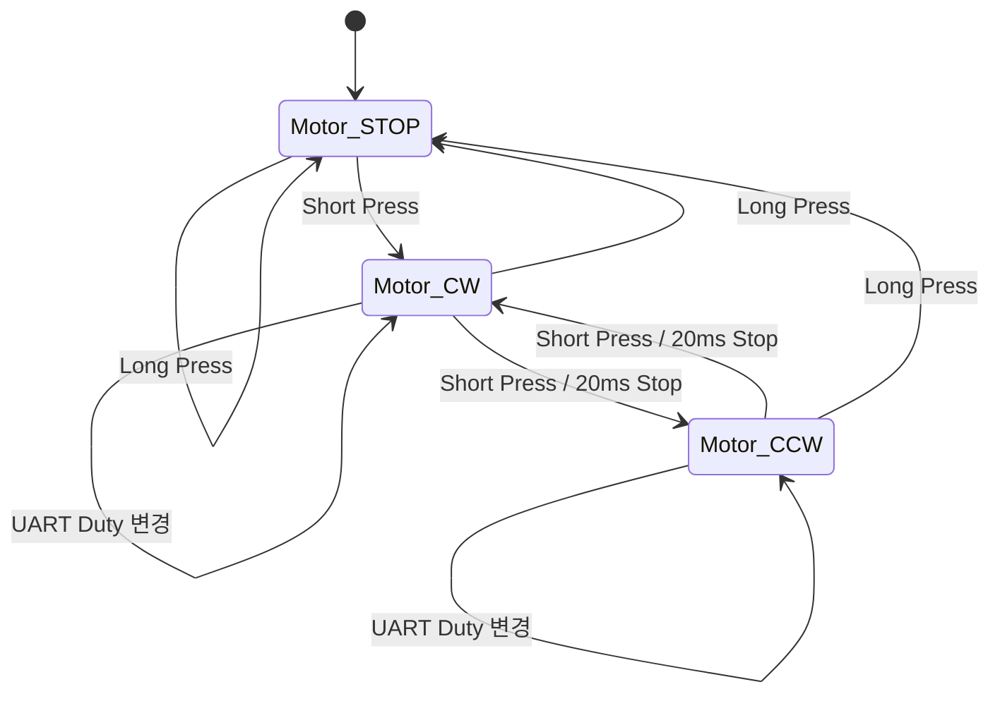
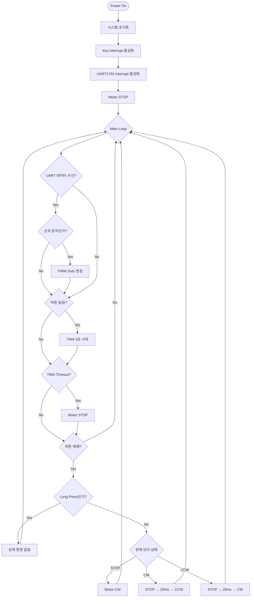

<<<<<<< HEAD
# 모터 인터럽트 제어 상위설계서

## 1. 프로젝트 개요

버튼 인터럽트, 타이머 인터럽트, UART 수신 인터럽트를 이용하여  
DC 모터의 회전 방향, 정지 상태 및 PWM 속도를 제어한다.

### 주요 기능

| 기능 | 설명 |
|---|---|
| 버튼 입력 | Short Press와 Long Press 구분 |
| 모터 방향 제어 | 시계 방향 및 반시계 방향 회전 |
| Long Press 제어 | 버튼을 3초 이상 누르면 모터 정지 |
| UART 속도 제어 | 숫자 입력에 따라 PWM Duty 변경 |
| 방향 전환 보호 | 방향 변경 전 모터를 20ms 동안 정지 |
| PWM 출력 | TIM5를 이용해 10kHz PWM 생성 |

---

## 2. Event & Action

인터럽트에서 입력 상태와 이벤트를 Flag에 저장하고,  
Main Loop에서 해당 Flag를 확인하여 모터 상태와 PWM Duty를 변경한다.

### 2.1 이벤트 처리표

| Event | 발생 조건 | Action |
|---|---|---|
| `UART_RX` | UART2 데이터 수신 | 숫자 문자에 따라 PWM Duty 변경 |
| `KEY_PRESSED` | 버튼을 누름 | Long Press 측정을 위한 TIM4 시작 |
| `TIM4_TIMEOUT` | 버튼을 누른 상태로 3초 경과 | 모터 정지 |
| `KEY_RELEASED` | 버튼을 뗌 | TIM4 정지 후 Short Press 동작 수행 |

### 2.2 Short Press 동작

| 현재 상태 | 동작 | 다음 상태 |
|---|---|---|
| `Motor_STOP` | 시계 방향 회전 | `Motor_CW` |
| `Motor_CW` | 20ms 정지 후 반시계 방향 회전 | `Motor_CCW` |
| `Motor_CCW` | 20ms 정지 후 시계 방향 회전 | `Motor_CW` |

### 2.3 Long Press 동작

버튼을 3초 이상 누르면 현재 모터 상태와 관계없이 모터를 정지한다.

```text
버튼 누름
    ↓
TIM4 3초 시작
    ↓
TIM4 Timeout
    ↓
Motor_STOP
```

Long Press 처리 후 버튼을 떼더라도 Short Press 동작은 수행하지 않는다.

### 2.4 UART 입력 동작

UART2로 숫자 문자 `'0'`부터 `'9'`까지 수신하여 PWM Duty를 변경한다.

```text
Duty = 수신 숫자 × 10%
```

| 입력 범위 | Duty 범위 |
|---|---:|
| `'0'` ~ `'9'` | 0% ~ 90% |

숫자가 아닌 문자를 수신하면 Duty와 모터 상태를 변경하지 않는다.

> [!NOTE]
> `'0'`을 수신하면 PWM Duty만 0%가 되며,  
> `Motor_CW` 또는 `Motor_CCW` 상태는 유지된다.

### 2.5 이벤트 처리 순서

Main Loop에서는 다음 순서로 이벤트를 처리한다.

```text
UART_RX → KEY_PRESSED → TIM4_TIMEOUT → KEY_RELEASED
```

TIM4 Timeout을 버튼 해제보다 먼저 처리하여  
Long Press와 Short Press가 중복 처리되지 않도록 한다.

---

## 3. 모터 상태 정의

```c
enum
{
    Motor_STOP,
    Motor_CW,
    Motor_CCW
};
```

| 상태 | 설명 |
|---|---|
| `Motor_STOP` | 모터 정지 |
| `Motor_CW` | 모터 시계 방향 회전 |
| `Motor_CCW` | 모터 반시계 방향 회전 |

---

## 4. 주요 상태 변수

| 변수명 | 자료형 | 설명 |
|---|---|---|
| `Key_Pressed` | `volatile int` | 버튼 누름 이벤트 |
| `Key_Released` | `volatile int` | 버튼 해제 이벤트 |
| `Key_State` | `volatile int` | 현재 버튼 상태 |
| `TIM4_Expired` | `volatile int` | TIM4 Timeout 발생 여부 |
| `Uart_Data` | `volatile unsigned char` | UART 수신 데이터 |
| `Uart_Data_In` | `volatile int` | UART 데이터 수신 여부 |
| `Duty` | `volatile int` | PWM Duty 값 |
| `state` | `int` | 현재 모터 상태 |
| `long_press_done` | `int` | Long Press 처리 완료 여부 |

인터럽트와 Main Loop가 함께 사용하는 변수는 `volatile`로 선언한다.

---

## 5. 타이머 및 PWM 구성

| Timer | 기능 |
|---|---|
| `TIM2` | 모터 방향 전환 전 20ms 정지 시간 생성 |
| `TIM4` | 버튼의 3초 Long Press 측정 |
| `TIM5` | 모터 속도 제어용 10kHz PWM 출력 |

### PWM 출력

| 모터 상태 | PWM 출력 |
|---|---|
| `Motor_CW` | TIM5 Channel 1 출력 |
| `Motor_CCW` | TIM5 Channel 2 출력 |
| `Motor_STOP` | 두 채널 출력 정지 |

UART로 `'0'`부터 `'9'`까지 입력받아 PWM Duty를
0%부터 90%까지 10% 단위로 변경한다.
---

## 6. 주요 함수

| 함수명 | 설명 |
|---|---|
| `Sys_Init(int baud)` | Clock, UART2, LED, TIM5 초기화 |
| `Key_ISR_Enable(int enable)` | 버튼 인터럽트 활성화 |
| `Uart2_RX_Interrupt_Enable(int enable)` | UART2 RX 인터럽트 활성화 |
| `TIM4_Repeat_Interrupt_Enable(int enable, int sec)` | Long Press 타이머 시작 및 정지 |
| `TIM2_Delay(int msec)` | 방향 전환 전 지연 |
| `Motor_Control(int state)` | 모터 상태에 따른 출력 제어 |
| `PORTA_Mode(int port)` | PA0, PA1의 GPIO 및 PWM 출력 설정 |
| `TIM5_Out_Init(void)` | TIM5 10kHz PWM 초기화 |

---

## 7. Motor Control FSM

### 7.1 상태 전이표

| 현재 상태 | Event | 다음 상태 |
|---|---|---|
| `Motor_STOP` | Short Press | `Motor_CW` |
| `Motor_CW` | Short Press | `Motor_CCW` |
| `Motor_CCW` | Short Press | `Motor_CW` |
| 모든 상태 | Long Press | `Motor_STOP` |
| 회전 상태 | UART 숫자 수신 | 현재 상태 유지, Duty 변경 |

### 7.2 FSM 다이어그램



---

## 8. 전체 동작 흐름



---

## 9. 모터 출력 동작

| 모터 상태 | PA0 / CCR1 | PA1 / CCR2 |
|---|---|---|
| `Motor_CW` | PWM 출력 | 0 |
| `Motor_CCW` | 0 | PWM 출력 |
| `Motor_STOP` | 0 | 0 |

방향 전환 시 현재 PWM 출력을 정지한 후  
20ms가 지나면 반대 방향 PWM을 출력한다.

--

# Motor_Contorl_Mini_Project

외부 버튼 인터럽트, USART 수신 인터럽트, TIMER 인터럽트를 이용하여 모터의 회전 방향과 속도 정지 상태를 제어하는 프로젝트 입니다.

각 인터럽트 서비스 루틴에서 입력을 확이하고 이벤트 플래그만 설정하며, 실제 모터 상태 변경과 제어는 Main Loop에서 실행합니다.
=======
# Motor_Contorl_Mini_Project

버튼 입력 시간을 판단하여 모터의 **시계 방향 회전**, **반시계 방향 회전**, **정지** 상태를 제어하는 프로젝트입니다.

버튼을 짧게 누르면 모터의 동작 또는 회전 방향이 변경되고, 버튼을 3초 이상 누르면 모터가 정지합니다.
>>>>>>> 52649a80ebe9a69a76d9a99bc1c86af4209db859

---

## 목차

1. [프로젝트 개요](#overview)
2. [Revision History](#revision)
<<<<<<< HEAD
3. [Event & Action](#event&action)
4. [Type 정의](#datatype)
5. [변수 정의](#variable)
6. [함수 정의](#function)
7. [FSM](#FSM)
=======
3. [자료형 정의](#datatype)
4. [변수 정의](#variable)
5. [함수 정의](#function)
6. [FSM](#FSM)
7. [event&action](#event&action)
>>>>>>> 52649a80ebe9a69a76d9a99bc1c86af4209db859
8. [Flowchart](#Flowchart)

---
<a name="overview"></a>

## 1. 프로젝트 개요

### 주요 기능

| 기능 | 설명 |
|---|---|
<<<<<<< HEAD
| Key Interrupt | 버튼의 누름과 버튼 해제 이벤트 감지 |
| UART2 RX Inerrupt | UART로 PWM Duty 명령 수신 |
| Timer Interrupt | 버튼을 3초 이상 누르는 long press 판단 |
| TIM5 PWM| 10KHz PWM을 이용한 모터 속도 제어|
| Motor FSM | 정지, 시계 방향, 반시계 방향 상태 관리 |
| 방향 전환 보호 | 방향 전환 전 모터를 짧게 정지하여 부하 감소 |
=======
| 버튼 입력 감지 | 버튼의 Falling Edge와 Rising Edge를 이용하여 입력 상태 확인 |
| 짧게 누르기 | 모터를 회전시키거나 현재 회전 방향 변경 |
| 길게 누르기 | 버튼을 3초 이상 누르면 모터 정지 |
| 방향 전환 보호 | 방향 전환 전 모터를 짧게 정지하여 부하 감소 |
| Timer2 사용 | 버튼을 누르고 있는 시간을 측정 |
| FSM 제어 | 모터 상태에 따라 시계 방향, 반시계 방향, 정지 동작 수행 |
>>>>>>> 52649a80ebe9a69a76d9a99bc1c86af4209db859

### 참여 인원

**곽혜민**, **도재우**,**박서희**

---
<a name="revision"></a>

## 2. Revision History

| NO. | DATE | Revision Record | REV. |
|---:|:---:|---|:---:|
| 1 | 2026.07.22 | Top Level Designs<br>모터 버튼 제어 | REV. 1.0 |
<<<<<<< HEAD
| 2 | 2026.07.24 | Top Level Designs<br>모터 버튼 제어 | REV. 2.0 |

---

<a name="event&action"></a>

## 3. Event & Action

인터럽트에서 입력 상태와 이벤트를 Flag에 저장하고,  
Main Loop에서 해당 Flag를 확인하여 모터 상태와 PWM Duty를 변경한다.

### 3.1 이벤트 처리표

| Event | 발생 조건 | Action |
|---|---|---|
| `UART_RX` | UART2 데이터 수신 | 숫자 문자에 따라 PWM Duty 변경 |
| `KEY_PRESSED` | 버튼을 누름 | Long Press 측정을 위한 TIM4 시작 |
| `TIM4_TIMEOUT` | 버튼을 누른 상태로 3초 경과 | 모터 정지 |
| `KEY_RELEASED` | 버튼을 뗌 | TIM4 정지 후 Short Press 동작 수행 |

### 3.2 Short Press 동작

| 현재 상태 | 동작 | 다음 상태 |
|---|---|---|
| `STOP` | 시계 방향 회전 | `TURN_COUNTER_CLOCKWISE` |
| `TURN_CLOCKWISE` | 20ms 정지 후 반시계 방향 회전 | `TURN_COUNTER_CLOCKWISE` |
| `TURN_COUNTER_CLOCKWISE` | 20ms 정지 후 시계 방향 회전 | `TURN_CLOCKWISE` |

### 3.3 Long Press 동작

버튼을 3초 이상 누르면 현재 모터 상태와 관계없이 모터를 정지한다.

```text
버튼 누름
    ↓
TIM4 3초 시작
    ↓
TIM4 Timeout
    ↓
Motor_STOP
```

Long Press 처리 후 버튼을 떼더라도 Short Press 동작은 수행하지 않는다.

### 3.4 UART 입력 동작

UART2로 숫자 문자 `'0'`부터 `'9'`까지 수신하여 PWM Duty를 변경한다.

### 3.5 이벤트 처리 순서

Main Loop에서는 다음 순서로 이벤트를 처리한다.

```text
UART_RX → KEY_PRESSED → TIM4_TIMEOUT → KEY_RELEASED
```

TIM4 Timeout을 버튼 해제보다 먼저 처리하여  
Long Press와 Short Press가 중복 처리되지 않도록 한다.

---

<a name="datatype"></a>

## 4. Type Definition

### 4.1 `MOTOR_STATE`
=======

---
<a name="datatype"></a>

## 3. Type Definition

### 3.1 `MOTOR_STATE`
>>>>>>> 52649a80ebe9a69a76d9a99bc1c86af4209db859

모터의 현재 동작 상태를 나타내는 열거형입니다.

```c
typedef enum
{
    TURN_CLOCKWISE = 0,
    TURN_COUNTER_CLOCKWISE = 1,
    STOP = 2
} MOTOR_STATE;
```

| 상태 | 값 | 설명 |
|---|---:|---|
| `TURN_CLOCKWISE` | 0 | 모터 시계 방향 회전 |
| `TURN_COUNTER_CLOCKWISE` | 1 | 모터 반시계 방향 회전 |
| `STOP` | 2 | 모터 정지 |

<<<<<<< HEAD
### 4.2 `BTN_STATE`
=======
### 3.2 `BTN_STATE`
>>>>>>> 52649a80ebe9a69a76d9a99bc1c86af4209db859

버튼이 눌려 있는지를 나타내는 열거형입니다.

```c
typedef enum
{
    IS_RELEASED = 0,
    IS_PRESSED = 1
} BTN_STATE;
```

| 상태 | 값 | 설명 |
|---|---:|---|
| `IS_RELEASED` | 0 | 버튼을 뗀 상태 |
| `IS_PRESSED` | 1 | 버튼을 누른 상태 |

---
<a name="variable"></a>

<<<<<<< HEAD
## 5. Flag Variable
=======
## 4. Flag Variable
>>>>>>> 52649a80ebe9a69a76d9a99bc1c86af4209db859

| 변수명 | 자료형 | 설명 |
|---|---|---|
| `prev_btn_state` | `BTN_STATE` | 이전 버튼 상태 저장 |
| `curr_btn_state` | `BTN_STATE` | 현재 버튼 상태 저장 |
| `is_timer_started` | `uint8_t` | 타이머의 동작 여부 표시 |
| `is_timer_timeout` | `uint8_t` | 타이머 Timeout 발생 여부 표시 |

<<<<<<< HEAD
---
<a name="function"></a>

## 6. Function Definition
=======
### Button State Value

| 버튼 상태 | 값 |
|---|---:|
| Pressed | 1 |
| Released | 0 |

---

<a name="function"></a>

## 5. Function Definition
>>>>>>> 52649a80ebe9a69a76d9a99bc1c86af4209db859

| NO. | 함수명 | 반환형 | 매개변수 | 기능 |
|---:|---|---|---|---|
| 1 | `Sys_Init` | `void` | `void` | Clock 초기화 |
| 2 | `GPIO_Init` | `void` | `void` | 모터 제어용 PA0, PA1 핀 초기화 |
| 3 | `Key_Poll_Init` | `void` | `void` | 보드 내부 스위치 초기화 |
| 4 | `Turn_Clockwise` | `void` | `void` | 모터 시계 방향 회전 |
| 5 | `Turn_Counter_Clockwise` | `void` | `void` | 모터 반시계 방향 회전 |
| 6 | `Stop` | `void` | `void` | 모터 정지 |
| 7 | `Short_Stop` | `void` | `int msec` | 방향 전환 전 모터를 짧게 정지 |
| 8 | `TIM2_One_Shot` | `void` | `int msec` | 지정된 시간만큼 Timer2 시작 |
| 9 | `TIM2_Check_Timeout` | `uint8_t` | `void` | Timer2 Timeout 발생 여부 검사 |

---

<a name="FSM"></a>

<<<<<<< HEAD
## 7. Motor Control FSM


### 7.1 Motor Control FSM State Definition
=======
## 6. Motor Control FSM


### 6.1 Motor Control FSM State Definition
>>>>>>> 52649a80ebe9a69a76d9a99bc1c86af4209db859

| State | 설명 |
|---|---|
| `STOP` | 모터 대기 및 정지 상태 |
| `TURN_CLOCKWISE` | 모터 시계 방향 회전 |
| `TURN_COUNTER_CLOCKWISE` | 모터 반시계 방향 회전 |
| `SHORT_STOP` | 방향 전환 시 모터 부하를 줄이기 위한 짧은 정지 |

<<<<<<< HEAD
### 7.2 Motor Control FSM State Transition
=======
### 6.2 Motor Control FSM State Transition
>>>>>>> 52649a80ebe9a69a76d9a99bc1c86af4209db859

| State Transition | 설명 |
|---|---|
| Button Press | 버튼 입력에 따라 모터 동작 상태 변경 |
| Timer2 Timeout | Timer2 Timeout 발생 시 모터 정지 |

<<<<<<< HEAD
### 7.3 State Transition 
=======
### 6.3 State Transition 
>>>>>>> 52649a80ebe9a69a76d9a99bc1c86af4209db859

| 현재 상태 | 이벤트 | 중간 동작 | 다음 상태 |
|---|---|---|---|
| `STOP` | 버튼 짧게 누름 | 없음 | `TURN_CLOCKWISE` |
| `TURN_CLOCKWISE` | 버튼 짧게 누름 | `SHORT_STOP` | `TURN_COUNTER_CLOCKWISE` |
| `TURN_COUNTER_CLOCKWISE` | 버튼 짧게 누름 | `SHORT_STOP` | `TURN_CLOCKWISE` |
| `TURN_CLOCKWISE` | Timer2 Timeout | 모터 정지 | `STOP` |
| `TURN_COUNTER_CLOCKWISE` | Timer2 Timeout | 모터 정지 | `STOP` |
| `STOP` | Timer2 Timeout | 정지 유지 | `STOP` |

---

<<<<<<< HEAD
=======
<a name="event&action"></a>

## 7. Event & Action

| Event | Action Requirement | Action |
|---|---|---|
| Key Pressed | 버튼이 처음 눌렸을 때 | 3초 Timer2 시작 |
| Key Released | Timeout 발생 전에 버튼을 뗐을 때 | Timer2 정지 및 현재 모터 상태에 따라 모터 제어 |
| Key Pressed | 버튼을 눌렀다가 떼었고 모터가 회전 중인 경우 | 모터 회전 방향 전환 |
| TIM2 Timeout | 버튼을 누르고 있는 동안 Timeout 발생 | UIF 확인 후 모터 정지 |

---

>>>>>>> 52649a80ebe9a69a76d9a99bc1c86af4209db859
<a name="Flowchart"></a>

## 8. Flow Chart


### 8.1 Flow Chart Detail

<details>
<summary><strong>전체 Flowchart 단계 보기</strong></summary>

| 노드 구분 | 단계명 | 상세 설명 | 연관 함수 및 변수 |
|---|---|---|---|
| Start | Power On | 시스템에 전원 공급 | - |
| Process | 초기화 | Clock, 내부 스위치, 모터 제어 핀 초기화 및 모터 정지 | `Sys_Init()`<br>`Key_Poll_Init()`<br>`GPIO_Init()`<br>`Stop()` |
| Decision | Button Falling Edge Detected | 버튼이 처음 눌렸으면 True | `curr_btn_state`<br>`prev_btn_state` |
| Process | `TIM2_One_Shot(3000)` | 3초 Timer2 시작 | `TIM2_One_Shot()` |
| Process | 타이머 플래그 설정 | Timeout 플래그를 0으로 설정하고 타이머 동작 플래그 Set | `is_timer_timeout`<br>`is_timer_started` |
| Decision | Button Rising Edge Detected | 버튼이 떼어졌으면 True | `curr_btn_state`<br>`prev_btn_state` |
| Process | Timer Stop | 버튼을 떼면 타이머 동작 플래그 Clear | `is_timer_started` |
| Decision | `is_timer_timeout` | Timeout 플래그가 1이면 True | `is_timer_timeout` |
| Decision | `state == STOP` | 현재 모터 상태가 정지이면 True | `state`<br>`STOP` |
| Process | `state = 1 - state` | 회전 중이면 상태값을 토글하여 방향 변경 | `state` |
| Process | `state = TURN_CLOCKWISE` | 정지 상태에서 버튼을 짧게 누르면 시계 방향 회전 | `state`<br>`TURN_CLOCKWISE` |
| Process | `state = STOP` | 버튼을 떼었을 때 이미 Timeout 상태라면 모터 정지 | `state` |
| Decision | Timer2 Timeout | Timeout이 발생했고 타이머가 동작 중이면 True | `TIM2_Check_Timeout()`<br>`is_timer_started` |
| Process | 상태 및 플래그 초기화 | 모터 정지 후 Timeout과 타이머 동작 플래그 Clear | `state`<br>`is_timer_timeout`<br>`is_timer_started` |
| Decision | State | 현재 `state` 값에 따라 모터 동작 결정 | `state` |
| Process | Clockwise | 모터 시계 방향 회전 | `Turn_Clockwise()` |
| Process | Counter Clockwise | 모터 반시계 방향 회전 | `Turn_Counter_Clockwise()` |
| Process | Stop | 모터 정지 | `Stop()` |
| Process | Default | 정의되지 않은 상태일 경우 모터 정지 | `Stop()` |

</details>

---

<<<<<<< HEAD
=======
## 최종 동작 정리

```text
1. 전원이 공급되면 시스템을 초기화하고 모터를 정지한다.

2. 버튼을 처음 누르면 Falling Edge를 감지한다.

3. Falling Edge가 감지되면 3초 Timer2를 시작한다.

4. 3초 전에 버튼을 떼면 Rising Edge를 감지한다.

5. 현재 모터가 정지 상태라면 시계 방향으로 회전한다.

6. 현재 모터가 회전 중이라면 잠시 정지한 후 반대 방향으로 회전한다.

7. 버튼을 누른 상태로 3초가 지나면 Timer2 Timeout이 발생한다.

8. Timeout이 발생하면 모터를 정지하고 관련 플래그를 초기화한다.
>>>>>>> 52649a80ebe9a69a76d9a99bc1c86af4209db859

9. 현재 state 값에 따라 모터 제어 함수를 실행한다.

10. 위 과정을 무한 반복한다.
```

